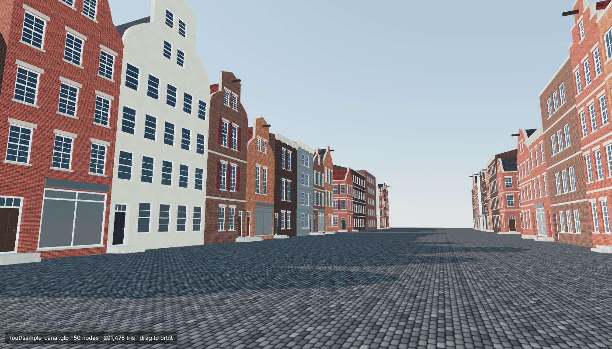
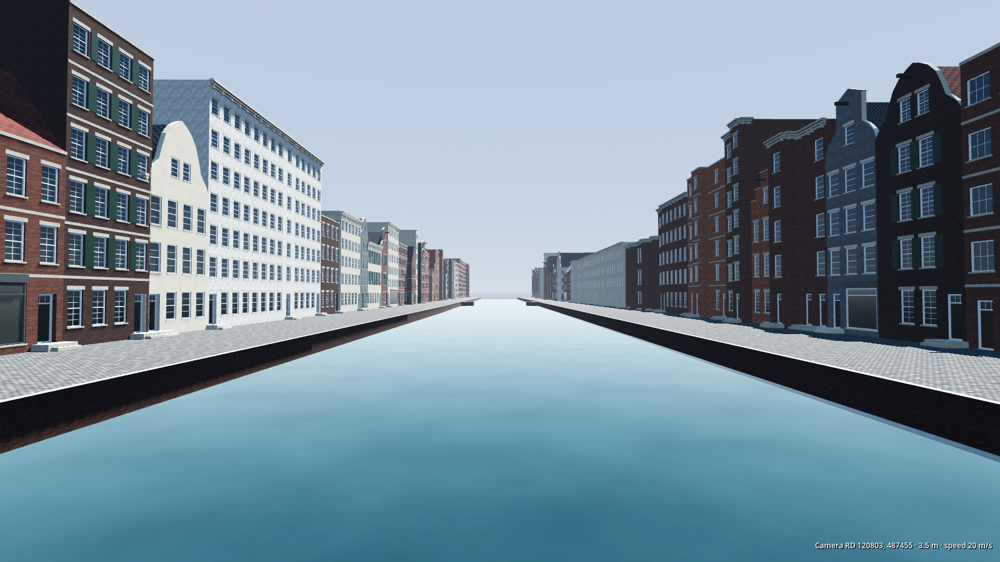

# gta-amsterdam: the facade upscaler

This pipeline turns Amsterdam's open 3D building data into detailed buildings
you can load in a game engine.

The open data (3D BAG, which is also the data the 3d.amsterdam.nl viewer shows)
gives each building its **true footprint, height and roof shape**. That stays
as the skeleton. Every exposed wall is then rebuilt as a procedural Amsterdam
facade:

- windows with depth, frames, glazing bars and sills
- doors with fanlights and stoops
- shopfronts with signboards, shutters and stone bands
- cornices with consoles
- step, neck, bell and spout gables, with a hoisting beam on top

The building's construction year (`oorspronkelijkbouwjaar`) picks the style:

| Year | Era | Facade |
|---|---|---|
| before 1720 | Golden Age | Gables |
| 1720–1900 | Classic | Cornices or neck/bell gables, often painted |
| 1900–1945 | Amsterdam School | Dark brick, horizontal panes |
| after 1945 | Post-war | Large openings, concrete |

Output is one `.glb` file with one node per building (named by its BAG id) and
embedded PBR textures (colour and normal maps). It loads in Godot, Unreal,
Unity, Blender and three.js.



> The screenshots show **synthetic test data** (`make_sample.py`): a fake canal
> street in the exact 3D BAG format. The pipeline was built in a sandbox that
> could not reach 3dbag.nl. Run the real data as shown below.

## Real Amsterdam via Overture Maps



Overture Maps publishes OpenStreetMap-based buildings (with measured heights for
most of Amsterdam) and water on a public bucket that needs no account. This
path builds the canal ring from that data:

```bash
python fetch_overture.py --center 52.3725 4.8865 --size 600 -o data/grachtengordel
python build_overture.py data/grachtengordel/buildings.pkl data/grachtengordel/water.pkl \
    --center 52.3725 4.8865 --size 450 400 -o out/amsterdam.glb
```

The fetcher reads only parquet footers and the matching row groups, a few MB
for a neighbourhood. It produces:

- footprints and heights from the data
- canals cut out of the cobbled ground, with brick quay walls
- houseboats moored at water level

Roofs are heuristic: Overture has no LoD2 roofs and little roof tagging, so a
narrow, deep, rectangular lot gets a canal-house gable roof and everything
else is flat. There is no construction year either, so styles are drawn at
random. 3D BAG (below) is more accurate on both counts.

The 450 x 400 m slice is 469 buildings and 1.9 M triangles: comfortable for a
desktop GPU, too much for a phone.

Credit: © OpenStreetMap contributors, Overture Maps Foundation (ODbL).

## Use (3D BAG)

```bash
pip install -r requirements.txt

# 1. Fetch real buildings (3D BAG, CC BY 4.0). Example: 400 m around the Dam.
python fetch_3dbag.py --center 52.3731 4.8926 --size 400 -o data/dam

# 2. Build the district
python build_city.py data/dam -o out/dam.glb

# Or from an OBJ export from 3d.amsterdam.nl (check its up axis)
python build_city.py export.obj --obj-up y -o out/export.glb
```

If the 3D BAG API has changed shape, download the CityJSON tiles for your area
from <https://3dbag.nl> (the tile viewer has a download button per tile) and
pass the files to `build_city.py`.

**Godot viewer:** `godot-viewer/` is a Godot 4.4+ tool. It opens any district
`.glb` and lets you fly, walk, click buildings to inspect them, colour by era,
and change the time of day. See `godot-viewer/README.md`.

Browser preview: run `python -m http.server` in this folder, then open
`http://localhost:8000/preview/viewer.html?glb=/out/dam.glb&view=street`. You
can also render screenshots headlessly with `preview/shoot.mjs`, which needs
Playwright.

Tests: `python -m unittest -v tests.test_pipeline`. They cover:

- every gable type hides the roof triangle
- openings stay inside the wall
- party-wall detection
- inside-out solid repair
- OBJ triangle merging
- byte-identical output for the same input and seed
- glTF well-formedness
- the RD coordinate conversion

## How it works

| File | Job |
|---|---|
| `amsterdam/sources.py` | Reads CityJSON, CityJSONSeq or saved API pages, and OBJ. Labels surfaces as wall/roof/ground, repairs inside-out solids, and welds and merges OBJ triangles back into planar faces. |
| `amsterdam/city.py` | Re-centres coordinates, finds **party walls** (pressed against a neighbour: left as plain brick, no windows into next door), and builds roofs (flat roofs get bitumen; pitched roofs get tiles laid down the slope) and the ground plane. |
| `amsterdam/facade.py` | **The upscaler.** Picks a style per building, lays out storeys and bays inside the real wall outline, cuts openings, and adds a gable silhouette that always covers the roof triangle. |
| `amsterdam/materials.py` | Seeded, tileable procedural textures: brick bond, pantiles, slate, cobbles and wood. |
| `amsterdam/gltf.py` | Dependency-free GLB writer (Y-up, vertices deduplicated). |
| `godot-viewer/` | Godot 4.4+ visualisation tool for the output. |

Scene origin and coordinate system: the glTF scene `extras` hold `origin_rd`
(RD New, EPSG:28992). glTF +X is east, +Y is up and -Z is north, in metres.
Tiles built separately therefore line up when each is placed at its own origin.

Output is deterministic: the same input and `--seed` always give the same
bytes. A different seed gives a different but plausible city.

## Limits and next steps

- **Street side vs back side.** Without street data every exposed wall is
  treated alike, so courtyard sides also get gables and doors. Next step:
  load OSM streets and canals (ODbL) and decorate only walls facing a street.
- **Terrain, canals, quays, bridges, trees.** The ground is currently one flat
  cobble plane. Add AHN for terrain and OSM/BGT for water and roads.
- **Performance.** About 4,000 triangles per house. A whole neighbourhood
  needs LODs: keep the raw 3D BAG LoD 2.2 as the far LOD (it is already
  correctly shaped), and add texture atlasing.
- **Roof detail.** Dormers, chimneys and roof windows are not generated yet.
- **Not real facades.** These are plausible period facades fitted to real
  buildings, not copies of the real ones. Matching specific landmarks needs
  hand-made hero assets.

## Licences and credit

3D BAG data is CC BY 4.0. Credit 3DBAG (3dbag.nl), by TU Delft's
3D geoinformation group and 3DGI. `fetch_3dbag.py` writes a `SOURCE.txt` with
the credit next to the data. three.js (MIT) is vendored in `preview/three/`.
