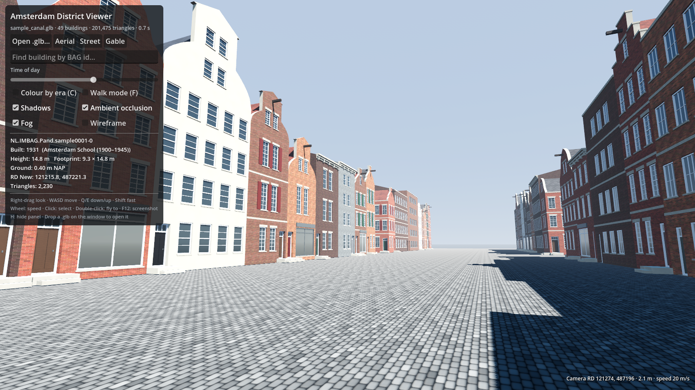
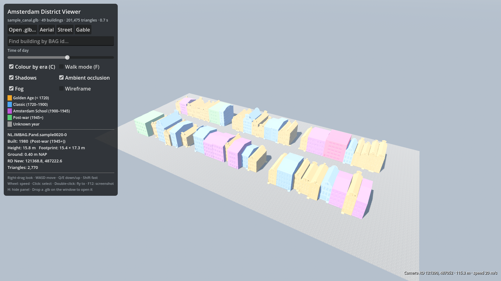

# Amsterdam District Viewer (Godot 4.4+)

A visualisation tool for the `.glb` districts that `build_city.py` writes. The
district loads at runtime, so you never import it into the project. Open any
district file and look around.




## Run

Open `godot-viewer/project.godot` in Godot 4.4 or newer and press Play. It
opens `../out/sample_canal.glb` if that file exists; create it with:

```bash
python make_sample.py && python build_city.py data/sample_canal.city.json -o out/sample_canal.glb
```

You can also open a district in either of these ways:

- **Open .glb…** in the panel, or drag a `.glb` onto the window.
- From the command line: `godot --path godot-viewer -- --glb=/path/to/dam.glb`

## Controls

| Input | Action |
|---|---|
| Right-drag | Look |
| WASD, Q/E | Move, down/up (Shift to go faster) |
| Mouse wheel | Fly speed |
| F | Walk mode: eye height on the ground, slides along walls |
| Click / double-click | Inspect a building / fly to it |
| C | Colour by era (construction year) |
| H | Hide the panel |
| F12 | Screenshot, saved to Godot's user data folder |
| Esc | Clear the selection |

The panel also has:

- views: aerial, street and gable
- search by BAG id
- a time-of-day slider for the sun
- toggles for shadows, ambient occlusion (Forward+ only), fog and wireframe

The inspector shows a building's:

- BAG id
- construction year and era
- height and footprint
- ground level (NAP)
- RD New coordinates

The camera's RD position is shown bottom right. Both come from the glTF
`extras`, which `amsterdam/gltf.py` writes and `glb_meta.gd` reads.

## Headless screenshots

Use this for docs or CI. It needs a display, for example `xvfb-run` on Linux:

```bash
xvfb-run -a godot --rendering-driver opengl3 --path godot-viewer --resolution 1600x900 -- \
  --glb=../out/sample_canal.glb --shot=$PWD/out/godot/street.png --view=street [--era] [--select=N]
```

The screenshots above were made this way with Mesa's software renderer
(Compatibility mode, so no SSAO). On a GPU with Forward+ it looks better.

## Notes

- Picking and walk mode use trimesh collision, generated once per building
  at load time. That is fine for a neighbourhood. For a whole city, load
  tiles instead.
- Textures loaded at runtime come without mipmaps, so the viewer generates
  them after loading. Without this, cobbles and brick shimmer at a distance.
